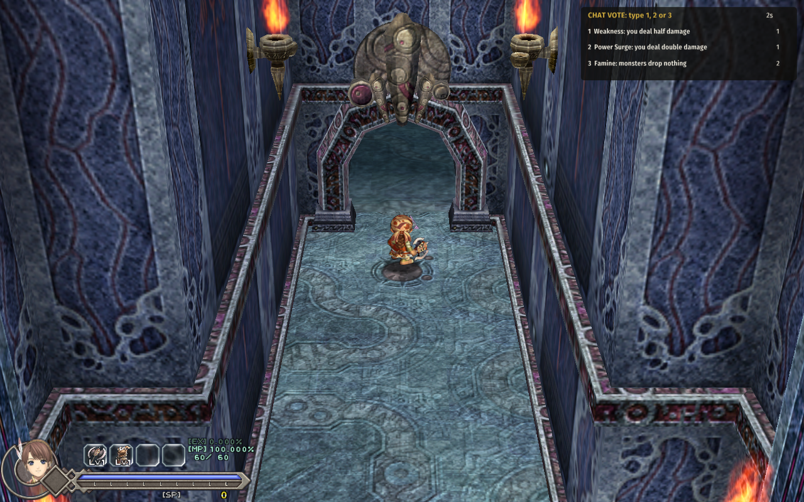

# Crowd Control

For **Ys Origin** on CleriaCore. Your **Twitch chat votes on what happens to you**. Every minute of play, three
random effects are put to a vote; viewers type `1`, `2` or `3`; the winner is applied.



| Effect | |
|---|---|
| Power Surge / Weakness | You deal double / half damage |
| Iron Skin / Glass Skin | You take half / double damage |
| Gold Rush, Wisdom | Triple SP, triple EXP |
| Famine | Monsters drop nothing |
| Heal | Half your max HP back, at once |
| Blood Tax | Lose a third of your HP, at once (it never kills) |
| Jackpot | SP for your level, at once |
| Supply Drop | Three Recovery Drops and a Strength Drop fall at your feet |

Timed effects last 30 seconds. One vote per viewer; the last one they type counts. A line that is not exactly
`1`, `2` or `3` is not a vote. A tie is broken at random. If nobody votes, nothing happens (or one of the three at
random, if you turn that on).

## Setup

1. Download `4rtefakt.crowd-1.0.0.cleriamod` from the [releases](../../releases), double-click it, turn
   **Crowd Control** on in F1 > Mods and restart CleriaCore.
2. **F1 > Mods > Crowd Control**: type your channel's name. The page shows `connected` and counts the chat lines
   it reads.

That is all: **no account, no token, no bot**. The mod reads chat the way a logged-out viewer does, and it can not
write to chat, so tell your viewers what the numbers on screen mean. The votes' pace, the voting time and the
effects' length are sliders on the same page, with a *Start a vote now* button.

Votes only run while you play: cutscenes, text boxes and the game-over screen pause the clocks.

## How it works

One Lua file, [main.lua](main.lua), about 210 lines. Twitch chat is IRC over a WebSocket, and an anonymous
read-only login is two lines:

```lua
local ws = cleria.net.websocket()
ws:open("wss://irc-ws.chat.twitch.tv:443")
-- on "open":
ws:send("NICK justinfan" .. math.random(10000, 99999))
ws:send("JOIN #" .. channel:lower())
-- each chat line: ":user!user@user.tmi.twitch.tv PRIVMSG #channel :text"
local user, text = line:match("^:([^!]+)![^ ]+ PRIVMSG #[^ ]+ :(.*)$")
local n = tonumber(text:match("^%s*([123])%s*$"))
if n and vote then vote.by[user] = n end
```

| Part | API |
|---|---|
| Chat | `cleria.net.websocket` over TLS (`open`, `poll` every frame, `send` for the PONG) |
| Timed effects | the `"damage"`, `"sp"`, `"exp"` and `"drop"` combat filters, read while the effect runs |
| Instant effects | `player.set_hp`, `player.add_sp`, `game.spawn_pickup` at `player.stats()`'s position |
| The clocks | the `tick` event, paused while `game.frozen()` |
| The vote panel, the settings | `cleria.hud.layer`, `cleria.ui.page` (text field, sliders, a button) |

## Tests

`python .dev/run.py` runs six cases through CleriaCore's headless harness against a small stand-in chat server
(`.dev/mock_twitch.py`, needs the Python package `websockets`): the handshake and the PONG; a scripted chat where
six lines give a 1 / 1 / 2 tally (a changed vote and a "2 please" handled) and the winner is applied; a vote with
no voters; and the effects on the engine's own numbers (Power Surge turns a 20-damage hit into 40, Iron Skin a 21
into 10, Glass Skin into 42, Blood Tax 60 HP into 40, Jackpot 100 SP at level 1, a timed effect ending).

`python .dev/run.py real_twitch` connects to the real Twitch endpoint anonymously and joins a public channel: that
passed, so the address, the TLS link and the login are right.

Not covered: a whole stream. Nobody has run it with real viewers voting yet, and the effects' balance is a first
guess.

## More CleriaCore mods

Each one is a small Lua mod that shows a different part of the mod API:

- [Mutators](https://github.com/4rtefakt/cleriacore-mutators): challenge rules: Glass Cannon, Berserker, One Hit, Vampire, Midas, Famine, Permadeath, a level cap
- [Solo Randomizer](https://github.com/4rtefakt/cleriacore-solo-randomizer): the tower's chests shuffled from a seed, always beatable, no server
- [Daily Challenge](https://github.com/4rtefakt/cleriacore-daily-challenge): the date shuffles the chests and picks two rules, the same for everyone
- [Roguelite Perks](https://github.com/4rtefakt/cleriacore-roguelite-perks): every boss beaten lets you choose one of three random perks
- [New Game+](https://github.com/4rtefakt/cleriacore-new-game-plus): start again with part of your level, SP and weapon against a harder tower
- [Level Sync](https://github.com/4rtefakt/cleriacore-level-sync): monsters fight as if they were near your level
- [Adaptive Difficulty](https://github.com/4rtefakt/cleriacore-adaptive-difficulty): enemies hit softer after each death, and return to normal as you progress
- [Achievements](https://github.com/4rtefakt/cleriacore-achievements): thirty achievements kept across all your saves
- [Run HUD](https://github.com/4rtefakt/cleriacore-run-hud): room and run time, kills, deaths, damage per second
- [Bestiary+](https://github.com/4rtefakt/cleriacore-bestiary): a per-save hunting log of every monster killed
- [Autosave+](https://github.com/4rtefakt/cleriacore-autosave): rolling autosaves on a timer, after bosses and in new zones
- [Debug Menu](https://github.com/4rtefakt/cleriacore-debug-menu): change level, SP, items, gear, skills, blessings, warps and flags
- [LiveSplit Autosplitter](https://github.com/4rtefakt/cleriacore-livesplit): starts and splits LiveSplit over its WebSocket server
- [Archipelago](https://github.com/4rtefakt/ys-origin-cleriacore-ap): the multiworld randomizer client, the biggest one

## About

Written with AI assistance (Claude Code) as a showcase of the CleriaCore mod API, and tested as described above.
MIT license.
